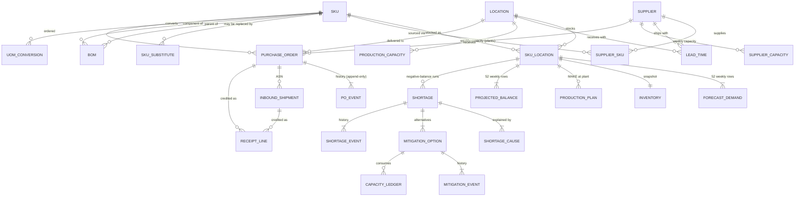

# Entity-relationship model

The full field list is in [data_dictionary.md](data_dictionary.md) and the DDL is in [../schema/schema.sql](../schema/schema.sql).

## Cardinality, optional relationships and lifecycles

| Relationship | Cardinality | Implemented by | Notes |
|---|---|---|---|
| SKU ↔ Location | N:M | bridge `sku_location` | A, B and C SKUs carried at 4–10, 2–6 and 1–3 locations |
| Supplier ↔ SKU | N:M | bridge `supplier_sku` | 1–3 approved suppliers per BUY SKU; exactly one primary |
| SKU ↔ SKU (substitute) | N:M | bridge `sku_substitute` | `review_status`: PENDING → APPROVED \| REJECTED |
| SKU ↔ SKU (BOM) | N:M | bridge `bom` | MAKE parent → BUY component |
| SKU-location → ForecastDemand | 1:N (exactly 52) | FK `(sku_id, location_id)` | SELL rows only |
| SKU-location → Inventory | 1:1 | natural key `(sku_id, location_id)` | |
| Supplier/Location → LeadTime | 1:N each | natural key `(supplier_id, location_id)` | `effective_from`, optional `effective_to` |
| Supplier → SupplierCapacity | 1:N (52 weeks) | natural key `(supplier_id, week)` | |
| PO → PO_Event | 1:N | FK `po_id`, `event_seq` 1..n | CREATED → CONFIRMED → SHIPPED (→ DELAYED); CREATED or CONFIRMED → CANCELLED |
| PO → InboundShipment | 1:0..1 expected | FK `po_id` | a second ASN is the `INBOUND_DOUBLE_COUNT` anomaly |
| PO → `substitute_for_sku_id` | optional N:1 to SKU | nullable FK | |
| Shortage → ShortageCause | 1:N | FK `shortage_id` | contributions sum to `shortage_qty` |
| Shortage → MitigationOption | 1:N | FK `shortage_id` | PROPOSED → SELECTED \| REJECTED |
| MitigationOption → CapacityLedger | 1:N | FK `mitigation_id` | supplier capacity, plant capacity, donor, substitute or component stock |

Effective dates appear on `sku`, `sku_location`, `supplier_sku`, `bom` and `lead_time`.

State changes are never overwritten. A PO's current `status` is **derived** from its latest non-DELAYED event, and the validator checks this. Delays add a `DELAYED` event carrying `new_promised_week`; the original `promised_week` is kept.
